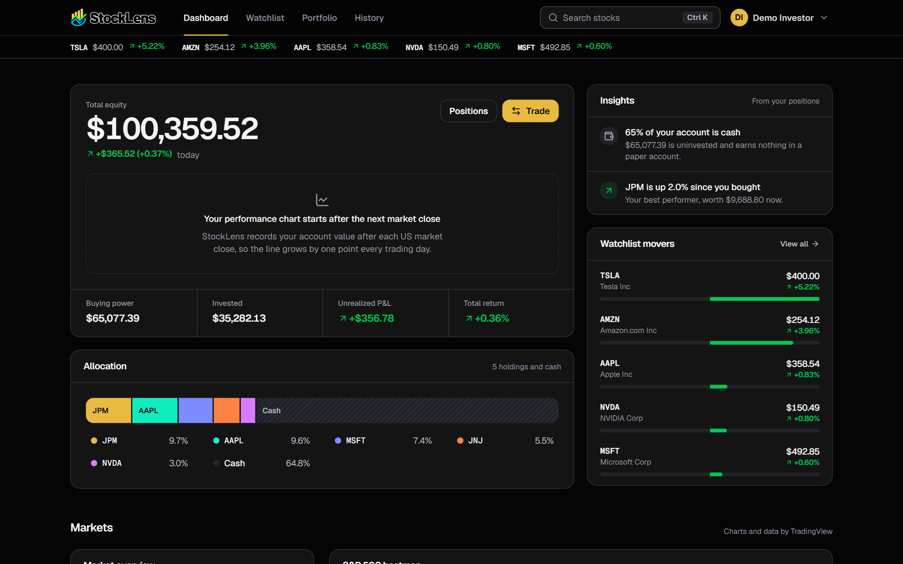
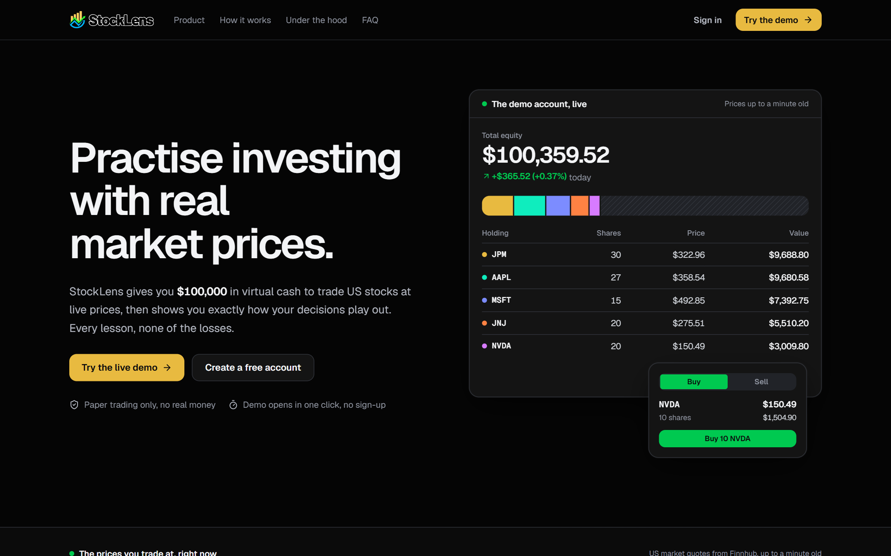
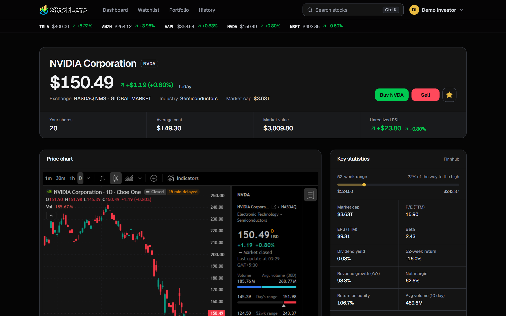
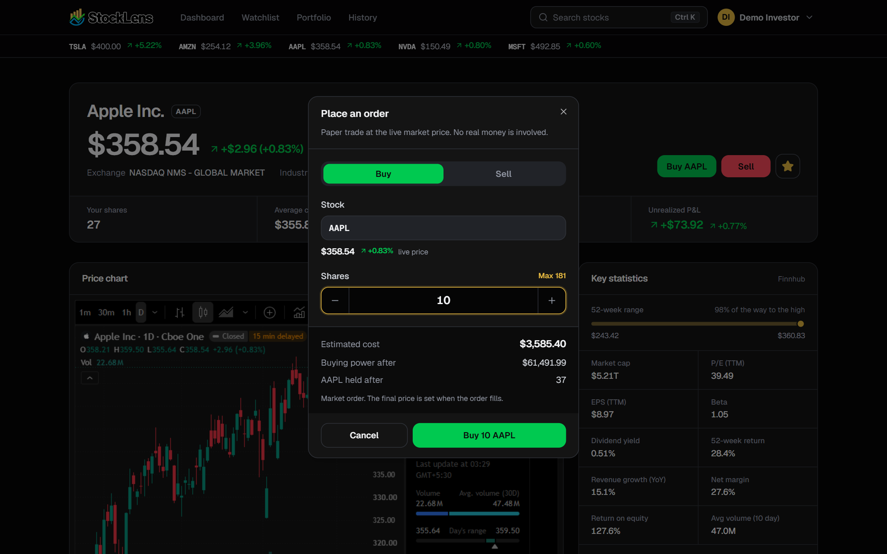
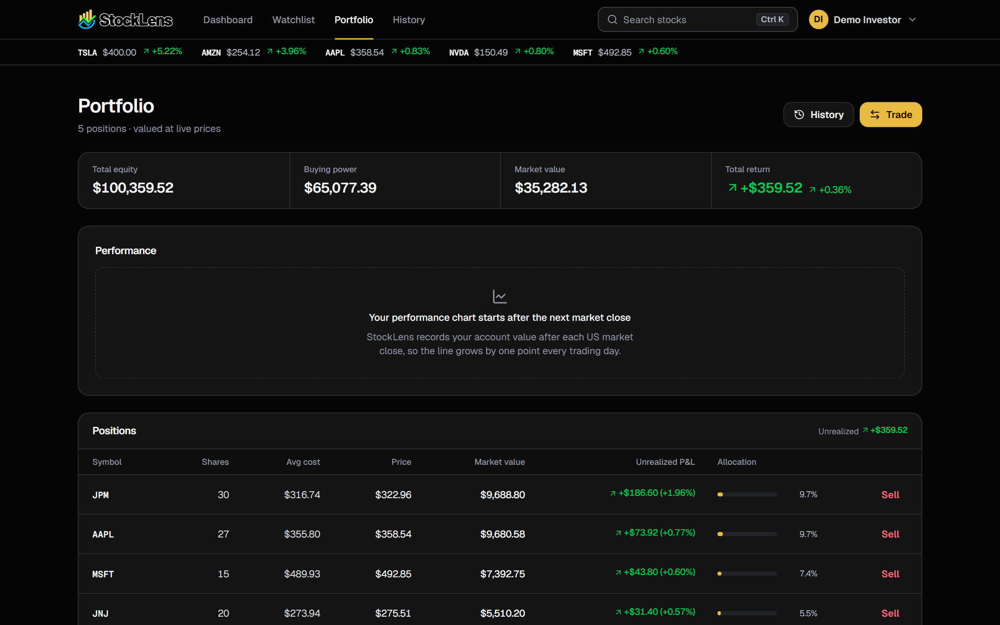
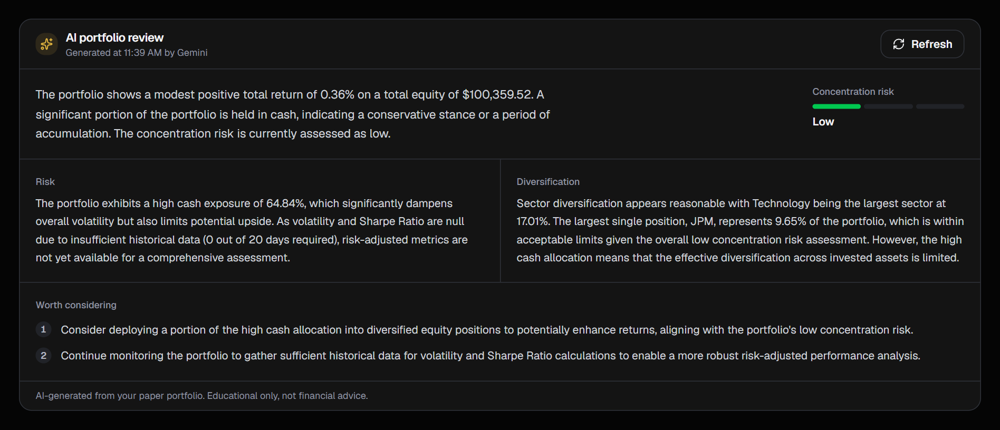
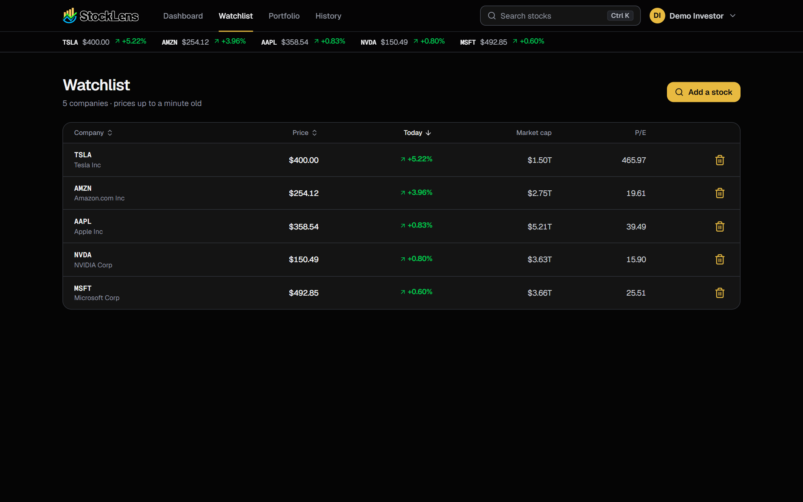
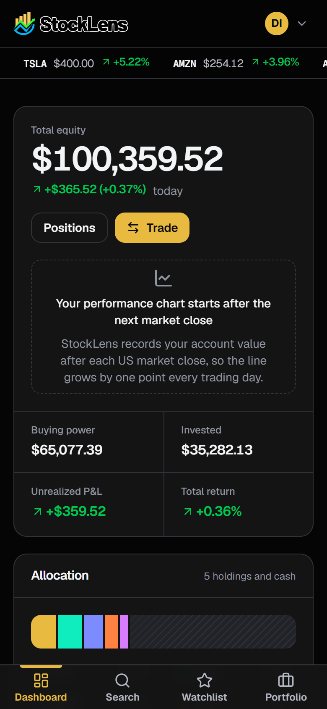

<div align="center">


### Practise investing with real market prices

Paper-trade US stocks with $100,000 in virtual cash, preview every order, see where your money is, and get an AI review of your portfolio.

**[Live app](https://stocklens-stock-tracker.vercel.app)** · **[Try the demo, no sign-up](https://stocklens-stock-tracker.vercel.app)** · [Architecture](./docs/architecture.md) · [Design system](./DESIGN.md)

[](https://github.com/Aditya-Khetawat/StockLens-Stock-Tracker-App/actions/workflows/ci.yml)



</div>

## What it is

StockLens is a paper-trading app that behaves like a real brokerage. Every account starts with $100,000 in virtual cash; every order is priced live from the US market feed and settled in a database transaction; holdings are derived from an append-only ledger; and the account is valued after every US market close so performance and risk metrics are honest rather than estimated.

Anyone can open the shared **demo account** in one click from the landing page. It starts with real holdings, and visitors' trades are undone every night.

> Paper trading only. No real money is involved, and nothing here is financial advice.

## Features

| | |
|---|---|
| **Live prices** | Quotes from Finnhub, cached for up to a minute. If the feed fails, cached prices keep pages readable, but orders are refused until a live price returns. |
| **Order ticket** | Buy or sell any US-listed stock in whole shares. The ticket shows the live price, the estimated cost or proceeds, and the cash and shares you will have afterwards. Max buys as many shares as your cash allows. |
| **Dashboard** | Total equity and today's change, a performance chart with 1W/1M/3M/YTD/All ranges, the whole account drawn as one allocation bar, insights computed from your positions, and your watchlist's biggest movers. |
| **Portfolio** | Positions with average cost, market value, unrealized P&L and allocation, plus a paginated trade history. |
| **Stock pages** | Price and day change, your position, interactive TradingView charts, and native key statistics: 52-week range, valuation, profitability and company facts. |
| **AI portfolio review** | On demand, Gemini reviews concentration, diversification and next steps from your live positions. It is told never to invent volatility or Sharpe figures before 20 days of history exist. |
| **Watchlist and search** | Keyboard-first search (`Ctrl/⌘ K`), a sortable watchlist, and a strip of your watchlist's prices on every page. |
| **Email** | Email verification, a personalised welcome email, and a daily news summary for your watchlist, with one-click unsubscribe. |
| **Responsive** | Designed for phones, tablets and desktops, with a bottom tab bar and stacked lists on small screens. |

## Screenshots

| | |
|---|---|
|  |  |
| **Landing page**: the live demo account and current prices | **Stock page**: price, your position, chart and key statistics |
|  |  |
| **Order ticket**: cost, cash after and shares after, before you commit | **Portfolio**: performance and positions |
|  |  |
| **AI review**: risk, diversification and next steps | **Watchlist**: sortable, with live prices |

<p align="center"></p>

## Tech stack

- **App:** Next.js 16 (App Router, server components, server actions, `proxy.ts`), React 19, TypeScript, Tailwind CSS 4, shadcn/ui primitives, Recharts, cmdk, Sonner
- **Data:** MongoDB (Atlas) via Mongoose, with multi-document transactions
- **Auth:** Better Auth (email and password, email verification)
- **Background jobs:** Inngest (welcome email, daily news, daily equity snapshots, nightly demo reset)
- **Market data:** Finnhub; charts embedded from TradingView
- **AI:** Google Gemini 2.5 Flash Lite
- **Email:** Nodemailer over Gmail SMTP
- **Quality:** Vitest with an in-memory MongoDB replica set, ESLint, GitHub Actions CI

## How it works

- **Trades** are validated with zod, rate-limited per user, then executed in one MongoDB transaction that checks cash or shares and writes the balance and the ledger entry together, so concurrent orders cannot overspend.
- **Holdings** are replayed from the trade ledger, so history and positions always agree.
- **Equity snapshots** are recorded after each US market close by an Inngest cron; the P&L chart and the AI review's risk metrics read them.
- **Server actions** are public endpoints by design, so each one checks the session itself, and CI fails the build if a new action appears outside an allowlist (`scripts/check-server-actions.mjs`).
- **The auth route** serves only the email-verification link; sign-in and sign-up go through validated, rate-limited server actions.

The full picture, with diagrams, a threat model and design decisions, is in [docs/architecture.md](./docs/architecture.md). The visual system (tokens, components, rules) is in [DESIGN.md](./DESIGN.md).

## Getting started

### 1. Install

```bash
git clone https://github.com/Aditya-Khetawat/StockLens-Stock-Tracker-App.git
cd StockLens-Stock-Tracker-App
npm install
```

### 2. Configure

```bash
cp .env.example .env.local
```

[`.env.example`](./.env.example) lists every variable the app reads, with a note on each: MongoDB, the Better Auth secret and URL, Finnhub, Gemini, Gmail SMTP credentials and the Inngest keys.

### 3. Database

Trades use MongoDB transactions, which need a replica set. MongoDB Atlas (any tier, including the free M0) already is one. Locally, start a single-node replica set:

```bash
docker run -d --name stocklens-mongo -p 27017:27017 mongo:7 --replSet rs0
docker exec stocklens-mongo mongosh --eval "rs.initiate({_id:'rs0',members:[{_id:0,host:'localhost:27017'}]})"
```

and set `MONGODB_URI=mongodb://localhost:27017/stocklens?replicaSet=rs0`.

### 4. Run

```bash
npm run dev                      # the app on http://localhost:3000
npx inngest-cli@latest dev       # optional: background jobs and emails
```

### Scripts

| Command | What it does |
|---|---|
| `npm run dev` | Development server |
| `npm run build` / `npm start` | Production build and server |
| `npm test` | Unit and integration tests (Vitest, in-memory MongoDB) |
| `npm run lint` | ESLint |
| `npm run typecheck` | TypeScript |
| `node scripts/check-server-actions.mjs` | After a build: fail if any server action is not allowlisted |

CI runs lint, tests, the production build and the server-action check on every push to main and every pull request.

## Project structure

```
app/
  (marketing)/landing   Public landing page (served at / for signed-out visitors)
  (auth)/               Sign-in and sign-up
  (root)/               Dashboard, portfolio, history, watchlist, stock pages
  api/                  Trade, quote, portfolio, AI review, auth, Inngest, health
components/             UI, including the order ticket, charts and dashboard panels
lib/
  services/             Trade execution, portfolio, snapshots, dashboard, landing
  portfolio/            Pure, tested portfolio math: ledger, valuation, metrics, insights
  finnhub/              Server-only Finnhub client with retries and a stale-price guard
  actions/              Server actions (session-checked, allowlisted)
database/models/        Mongoose models
docs/architecture.md    Architecture, threat model, decisions
DESIGN.md               Design system
```

## Limitations

- US-listed stocks only, whole shares, market orders only. No options, short selling or limit orders.
- Finnhub's free tier allows 60 requests a minute, so quotes are cached for up to a minute.
- The performance chart and risk metrics fill in one point per trading day; a new account shows them after its first market close.
- Some TradingView widgets cannot be themed or embedded here, so stock pages use native key statistics instead.

## Acknowledgments

[Finnhub](https://finnhub.io) for market data, [TradingView](https://www.tradingview.com) for charts, [Better Auth](https://www.better-auth.com), [Inngest](https://www.inngest.com), [shadcn/ui](https://ui.shadcn.com) and [Google Gemini](https://ai.google.dev).

## License

[MIT](LICENSE)
