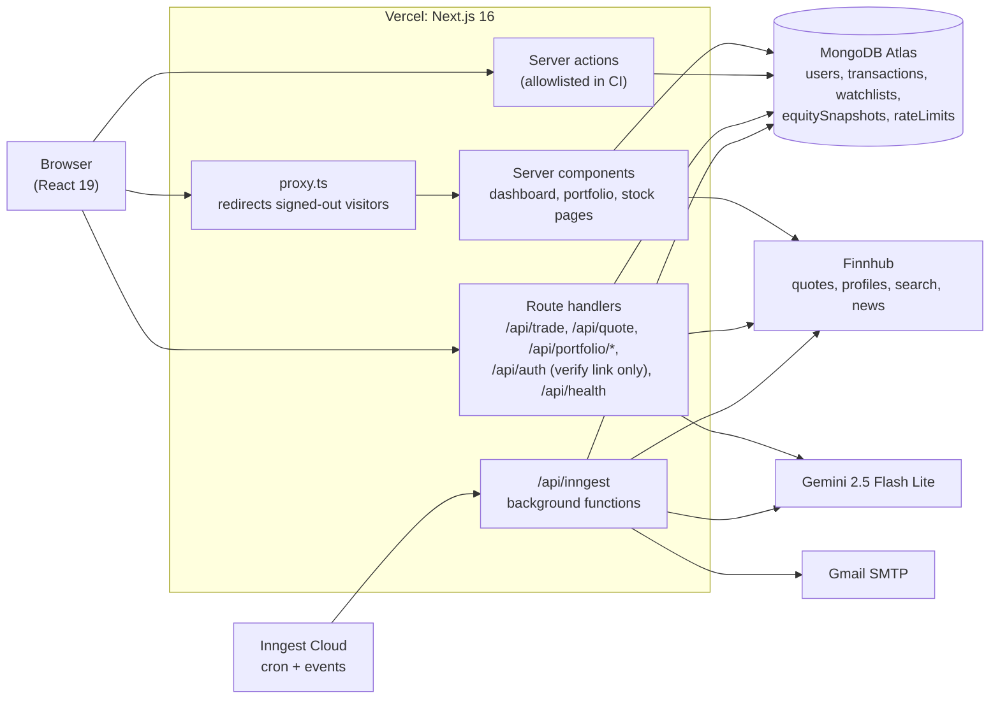
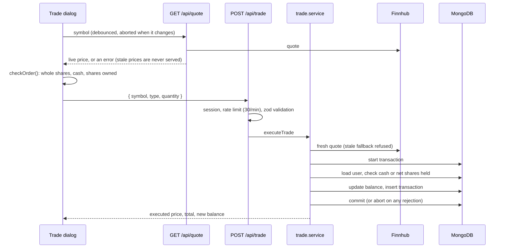

# StockLens architecture

StockLens is a paper-trading app: every account starts with $100,000 in virtual cash, buys and sells US stocks at live Finnhub prices, and gets daily email summaries and AI analysis of its portfolio. This page explains how the pieces fit, how a trade executes, what the app defends against, and three design decisions.

## System overview

- **Authentication** is Better Auth with the MongoDB adapter. Sign-up, sign-in, sign-out and the demo login run as server actions, which validate input with zod and rate-limit by IP before calling `auth.api`. The `/api/auth` route serves only the email verification link; every other Better Auth endpoint returns 404 (`lib/better-auth/public-routes.ts`).
- **Market data** goes through one server-only Finnhub client (`lib/finnhub/client.ts`). It builds every URL from a fixed base, retries transient failures with backoff, and caches through Next's fetch cache: quotes for 60 s, company profiles and metrics for 1 h, search for 30 min, news for 5 min.
- **Background work** runs in Inngest:

  | Function | Schedule (UTC) | What it does |
  |---|---|---|
  | Welcome email | On sign-up | Waits for email verification, then sends |
  | `daily-news-summary` | 12:00 daily | Sends watchlist news to verified, subscribed users |
  | `reset-demo-account` | 21:00 daily | Resets the shared demo account |
  | `snapshot-daily-equity` | 21:30 weekdays, after the US close | Records each trading user's equity for the P&L chart and risk metrics |

- **Portfolio math** is pure and unit-tested (`lib/portfolio/engine.ts`, `lib/portfolio/metrics.ts`). Services load data and pass it in, so no calculation touches the network or database.

## How a trade executes

The price shown in the dialog is an estimate. The server prices the order again inside `executeTrade`, and the toast shows the price the order actually filled at. Every amount is rounded to cents before it is stored.

## Threat model

| Threat | Defence |
|---|---|
| Calling server actions or routes without a session | Each one checks the session itself. CI fails the build if a new server action appears outside the allowlist (`scripts/check-server-actions.mjs`). |
| Using StockLens to send arbitrary Finnhub requests (SSRF) | The Finnhub client fixes the base URL and is server-only; callers choose only a path and validated parameters. |
| Double-spending or overselling through concurrent orders | The balance and holdings checks and the writes happen inside one MongoDB transaction, so concurrent orders conflict and retry. |
| Brute force or quota abuse | Fixed-window limits stored in MongoDB: orders, market data, AI analysis, sign-up and sign-in (`lib/rate-limit.ts`). |
| Abusing the email pipeline | HTML is escaped and sanitised. Mail goes only to verified addresses, and every email has an HMAC-signed one-click unsubscribe link (RFC 8058). |
| Taking over or locking the shared demo account | Its password is derived from the auth secret. The address is reserved at sign-up, and the account-management endpoints aren't served. |

## Decisions

### 1. MongoDB multi-document transactions for trades

**Context:** a trade must check cash or shares and then write both the balance and the ledger entry. Done as separate writes, two concurrent orders could both pass the check.

**Decision:** run every trade in `session.withTransaction`. This requires a replica set: Atlas always provides one, and local development uses a single-node replica set (see the README).

**Consequence:** correctness comes from the database rather than application locks, at the cost of the replica-set requirement and occasional transaction retries under contention.

### 2. A ledger, not a positions table

**Context:** holdings could be stored as mutable rows (symbol, quantity, average cost) or derived from the trade history.

**Decision:** the `transactions` collection is the source of truth, and `replayLedger()` derives holdings and average cost from it. Only cash is stored on the user.

**Consequence:** there is one source of truth, a full audit trail, and history and positions can never disagree. The cost is replaying a user's trades on each portfolio load, which is cheap at paper-trading volumes and indexed by `{ userId, createdAt }`. If it ever became slow, a cached positions projection could be rebuilt from the ledger at any time.

### 3. Finnhub through Next's fetch cache, with a short stale fallback

**Context:** Finnhub's free tier allows 60 calls a minute, and every page shows prices.

**Decision:** cache each endpoint for as long as its data stays useful (see the cache times above). If Finnhub fails, the last good quote from the past 15 minutes is returned, marked `stale`.

**Consequence:** pages keep rendering through short outages. Trades and the trade dialog refuse stale prices, so nothing ever fills at an outdated price. The fallback is per server instance, so it is best-effort on serverless.
